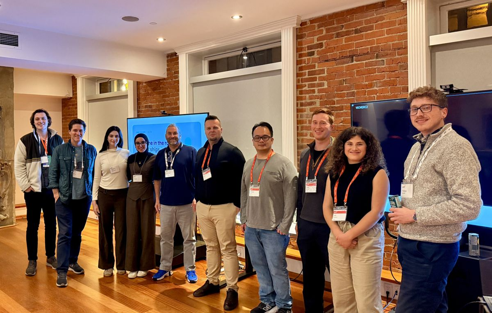

If you're reading this, the newsletter works. Hi! You're one of the first handful of people on this list, so thank you for raising your hand early.

A quick recap: on November 5, about fifteen of us gathered downtown for our Fall Event. There was a social, a look inside Harvey AI, some Q&A, and then more social. Afterwards we asked everyone who registered what worked and what didn't. More on that below, but first, the talk.

## The talk: Harvey at PwC

Our main session looked at Harvey, the AI platform PwC uses for legal, tax and deals work, and how it reached more than 25,000 PwC staff. For product people, the interesting part wasn't the tool itself but the decisions behind it: PwC chose to license a platform and build its own workflows on top rather than start from scratch, and treated security and trust as part of the product from day one.

Two takeaways worth borrowing:

- **Retrieve, don't retrain.** Harvey doesn't learn from client data. It finds the relevant documents when you ask, cites them, and leaves the model unchanged. A focused question gets a sharper answer than a bigger pile of documents.
- **Adoption is part of the product.** Training before anyone gets access, champions on each team, and reclaiming licences that sit unused for 60 days were planned as part of the rollout, not added afterwards.

Want the details? The one-page brief from the talk covers how Harvey works, how it's built to be trusted, and all five lessons for product owners. It lives on our new [Resources](/resources) page, alongside future take-homes from our sessions.

<a class="btn btn-coral" href="/resources/brief-01-harvey-at-pwc.pdf" target="_blank" rel="noopener">Download the brief (PDF)</a>

## What you told us

- **The people were the highlight.** Every attendee who answered named meeting people at the social as the best part of the night.
- **Shorter talk, longer Q&A.** The clearest feedback: *"The Q&A was the best part, the talk itself dragged a bit towards the end."* Noted. Next time the conversation gets more room, and we'll share a few starter questions in advance so it's easier for everyone to jump in.
- **Practical over hype.** Discovery and research topped the list of topics you want, followed by roadmapping and founder stories from local companies. AI came in lower than you might guess.
- **Talks with Q&A, and lunch-and-learns.** Both formats got a yes from everyone who answered.
- **No pitches.** You asked for a room built on candour and real work, not sales. That's the bar we're holding ourselves to.

## In your words

We asked one question we keep coming back to: *what would make ProductHub Victoria indispensable to you?*

> If I could come away with a new idea or approach to take back to work, and meet someone new, I would consider these must-attend events.
>
> — A product manager

> A place to meet other like-minded product people without pitches or vanity projects. A focus on authenticity, rigor and taste.
>
> — A product leader

> A regular meeting of highly skilled and accomplished interdisciplinary professionals mixed with emerging builders.
>
> — A founder

> Killer presentations of on-trend product topics from storytellers who I can feel personally connected to at a local level.
>
> — A consultant

> Learnings, and more importantly, how to apply those learnings.
>
> — An operations leader

And our favourite note: *"So great to have a more local event."* Several of you also offered to speak, host or help organise. Thank you. We'll be in touch.

## What we're thinking about

Danijel and I have been sketching where this could go. Nothing is locked in yet, but a few ideas keep coming up:

- **What happens after launch.** Victoria has great groups for getting started. Fewer go deep on what comes next: growing a team, earning the trust of bigger customers, raising money, even selling a company. We think there's room for a candid, recurring conversation about those middle years.
- **Real work, shown.** Smaller rooms where people walk through actual roadmaps, documents and decisions, including the ones that went sideways, and you leave with something you can reuse.
- **The whole team in the room.** Product, design, engineering, QA and support together, not just product managers.
- **Pointing you to the right room.** There's a lot happening on the Island. We'd like to help you find the groups that fit what you need, even when that isn't us.

If any of that sparks something, or there's a story you'd want to tell, email us at [hello@producthub.info](mailto:hello@producthub.info). We read everything.

## What's next

We're planning our next event for the new year, and subscribers will hear about it first. In the meantime, [the Slack](/#slack) is where the conversation keeps going, and [the website](/) has everything else.

Thanks for being here at the very start.

*Michael & Danijel*\
*Co-founders, ProductHub Victoria*
